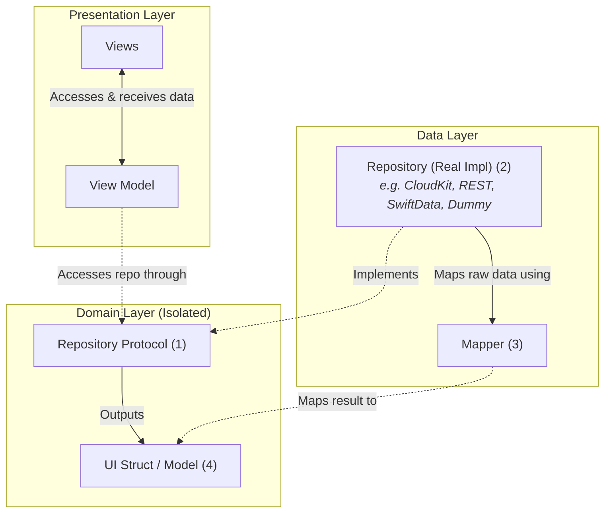

# Feature-Driven Clean Architecture Guide

A generalized architectural guide for structuring self-contained feature packages in modern Swift & SwiftUI applications.

---

## 1. Architectural Blueprint

Every feature in the application is modeled as an independent, modular package containing three distinct layers: **Domain**, **Data**, and **Presentation**.



---

## 2. The Three Layers

### 2.1. Domain Layer &mdash; *The Isolated Core*
The Domain layer contains the feature's business contracts and definitions. It is strictly **isolated** and framework-agnostic.

* **Characteristics**:
  - **No external dependencies**: Pure Swift / Foundation only. No imports of SwiftUI, CloudKit, database engines, or networking libraries.
  - **Self-contained**: Both Data and Presentation layers depend on Domain; Domain depends on **nothing**.

* **Core Components**:
  1. **Repository Protocol (1)**:
     - Defines *what* operations the feature requires (e.g. `fetchItems()`, `saveItem()`, `deleteItem()`).
     - Returns **UI Structs (4)** directly to the caller using async/await and typed errors.
  2. **UI Struct (4)**:
     - The domain model formatted and optimized for presentation.
     - Contains sanitized, display-ready data (e.g., formatted dates, localized labels, presentation-level enums).

---

### 2.2. Data Layer &mdash; *Persistence, Networking, & Translation*
The Data layer handles physical communication with backends, databases, or in-memory stores, and translates raw inputs into clean domain models.

* **Characteristics**:
  - **Depends only on Domain**: Implements the protocols defined in the Domain.
  - **Information hiding**: Raw backend models (DTOs, JSON dictionaries, `CKRecord` objects) are strictly internal to this layer and **never** leak into Domain or Presentation.

* **Core Components**:
  1. **Raw Data Model / DTO**:
     - Represents the exact structure of incoming data from APIs, CloudKit, local SQLite, or caches.
     - Holds raw primitives (e.g., epoch timestamps, integer flags, database keys).
  2. **Mapper (3)**:
     - Pure conversion logic: `map(from: RawDTO) -> UIStruct`.
     - Handles date parsing, fallback defaults for optional properties, and mapping raw codes to domain enums.
  3. **Repository Implementation (2)**:
     - Conforms to the **Repository Protocol (1)**.
     - Performs the actual data retrieval (e.g., CloudKit queries, network requests, or mock storage).
     - Feeds raw results through the **Mapper (3)** and returns the resulting **UI Structs (4)**.
     - **Replaceability**: Designed so that production repositories (e.g., CloudKit) can be effortlessly replaced with dummy/mock implementations for testing, previews, or offline fallback.

---

### 2.3. Presentation Layer &mdash; *State & User Experience*
The Presentation layer is responsible for rendering the interface and responding to user actions.

* **Characteristics**:
  - **Depends only on Domain**: Never imports or references the Data layer directly.
  - Interacts with data sources purely through the **Repository Protocol (1)**.

* **Core Components**:
  1. **View Model**:
     - Holds a reference to `any RepositoryProtocol` supplied via **Dependency Injection**.
     - Manages presentation state (e.g., loading states, error handling, filtering, sorting).
     - Invokes protocol methods in response to user actions and updates observable state.
  2. **Views**:
     - Declarative SwiftUI views bound to the ViewModel.
     - Reads state from the ViewModel and delegates all user intent (taps, pulls to refresh, inputs) directly to the ViewModel.

---

## 3. Dependency Rules & Boundaries

| Layer | Can Import / Depend On | Must Never Depend On |
| :--- | :--- | :--- |
| **Domain** | *Nothing* (Pure Swift / Foundation) | Data, Presentation, UI Frameworks, CloudKit, Networking |
| **Data** | **Domain** | Presentation, UI Frameworks (SwiftUI/UIKit) |
| **Presentation** | **Domain**, UI Frameworks (SwiftUI) | Data (Concrete Repositories, DTOs, Mappers) |

> [!IMPORTANT]
> **Dependency Inversion Principle (DIP)**:
> Neither Presentation nor Domain depends on the Data layer. The concrete repository is instantiated at the composition root (e.g., App or Coordinator) and injected into the ViewModel as `any FeatureRepositoryProtocol`.

---

## 4. Feature Package Directory Layout

Every feature package follows this standard layout:

```text
[FeatureName]/
├── Domain/
│   ├── [Feature]Item.swift                 // (4) UI Struct / Domain Model
│   └── [Feature]RepositoryProtocol.swift   // (1) Repository Protocol
│
├── Data/
│   ├── [Feature]DTO.swift                  // Raw data transfer object
│   ├── [Feature]Mapper.swift               // (3) Mapper: RawDTO -> UI Struct
│   └── [Feature]Repository.swift           // (2) Repository: Real (CloudKit/API) & Dummy
│
└── Presentation/
    ├── [Feature]ViewModel.swift            // ViewModel (accesses Repo Protocol)
    └── [Feature]View.swift                 // Views (renders UI from ViewModel)
```

---

## 5. Universal Code Blueprint

Below is the generic implementation template for any new feature package:

### 5.1. Domain
```swift
// Domain/[Feature]Item.swift
public struct FeatureItem: Identifiable, Equatable, Sendable {
    public let id: String
    public let title: String
    public let formattedDate: String
}

// Domain/[Feature]RepositoryProtocol.swift
public protocol FeatureRepositoryProtocol: Sendable {
    func fetchItems() async throws -> [FeatureItem]
    func saveItem(title: String) async throws -> FeatureItem
}
```

### 5.2. Data
```swift
// Data/[Feature]DTO.swift
public struct FeatureDTO: Sendable {
    public let recordId: String
    public let rawTitle: String?
    public let epochSeconds: Double?
}

// Data/[Feature]Mapper.swift
public struct FeatureMapper: Sendable {
    public func map(from dto: FeatureDTO) -> FeatureItem {
        FeatureItem(
            id: dto.recordId,
            title: dto.rawTitle ?? "Untitled",
            formattedDate: formatDate(dto.epochSeconds)
        )
    }
}

// Data/[Feature]Repository.swift
public actor FeatureRepository: FeatureRepositoryProtocol {
    private let mapper: FeatureMapper

    public init(mapper: FeatureMapper = FeatureMapper()) {
        self.mapper = mapper
    }

    public func fetchItems() async throws -> [FeatureItem] {
        // 1. Fetch raw DTOs (from CloudKit, API, or local store)
        let dtos: [FeatureDTO] = try await loadRawData()
        // 2. Map through mapper to UI Structs
        return dtos.map { mapper.map(from: $0) }
    }
}
```

### 5.3. Presentation
```swift
// Presentation/[Feature]ViewModel.swift
@Observable
@MainActor
public final class FeatureViewModel {
    private let repository: any FeatureRepositoryProtocol
    public var items: [FeatureItem] = []
    public var isLoading: Bool = false

    public init(repository: any FeatureRepositoryProtocol) {
        self.repository = repository
    }

    public func load() async {
        isLoading = true
        defer { isLoading = false }
        self.items = (try? await repository.fetchItems()) ?? []
    }
}

// Presentation/[Feature]View.swift
public struct FeatureView: View {
    @State private var viewModel: FeatureViewModel

    public init(viewModel: FeatureViewModel) {
        _viewModel = State(initialValue: viewModel)
    }

    public var body: some View {
        List(viewModel.items) { item in
            Text(item.title)
        }
        .task {
            await viewModel.load()
        }
    }
}
```

---

## 6. Key Benefits

1. **Schema & Backend Isolation**:
   If backend fields change, only `FeatureDTO` and `FeatureMapper` are updated. Zero ripple effect onto Domain or UI.

2. **Plug-and-Play Repositories**:
   Easily toggle between **CloudKit**, **REST APIs**, **Local SQLite/SwiftData**, and **Mock/Dummy Repositories** without altering the UI or ViewModel.

3. **Isolated Testability**:
   - ViewModels are tested using lightweight mock repositories conforming to the protocol.
   - Mappers are tested with pure, fast unit tests without network or disk I/O.

4. **Scalability**:
   Features can be developed in parallel across different feature packages, framework targets, or Swift Packages with clean boundary encapsulation.
